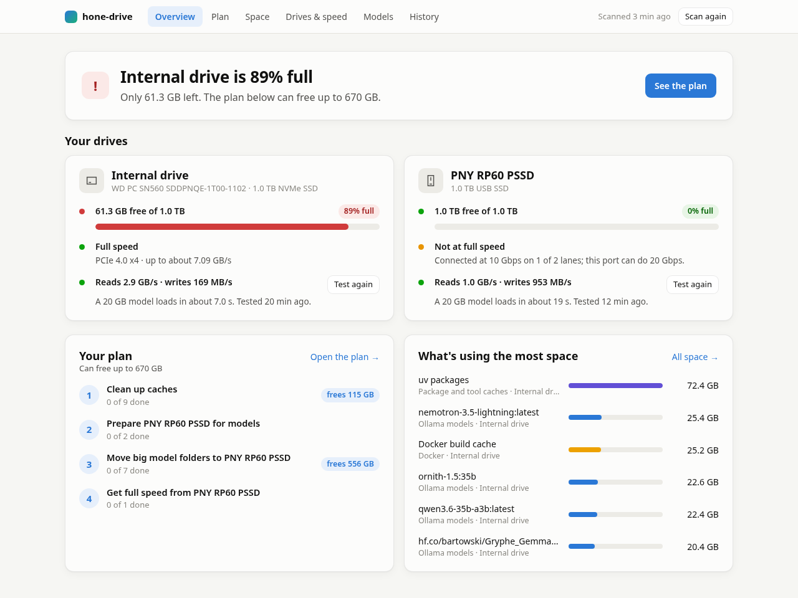
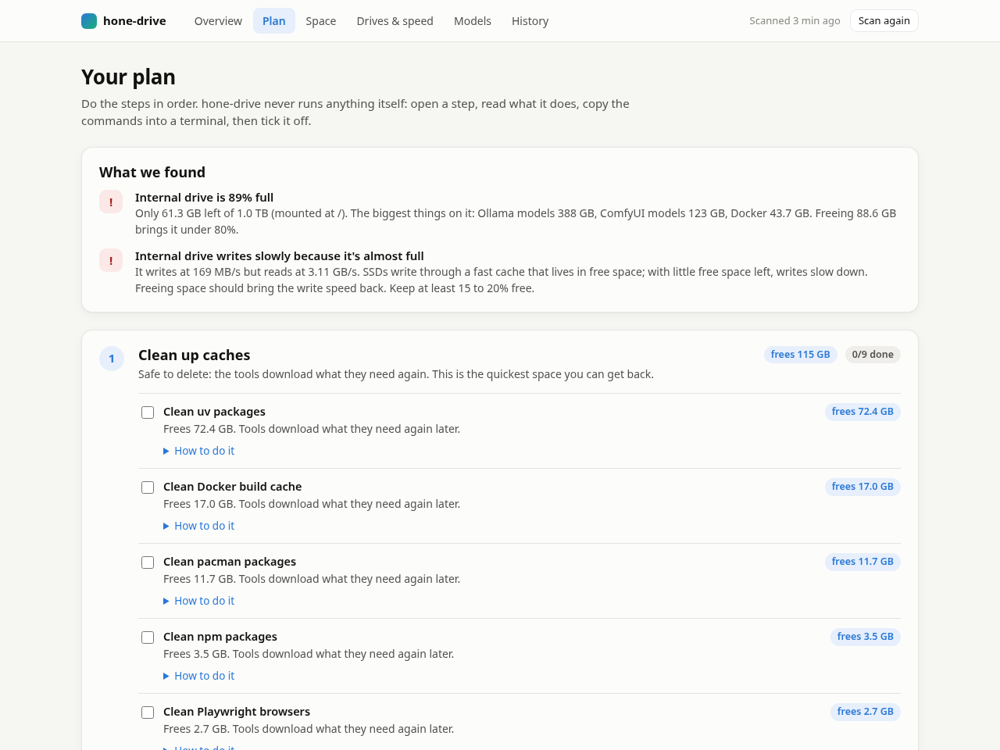
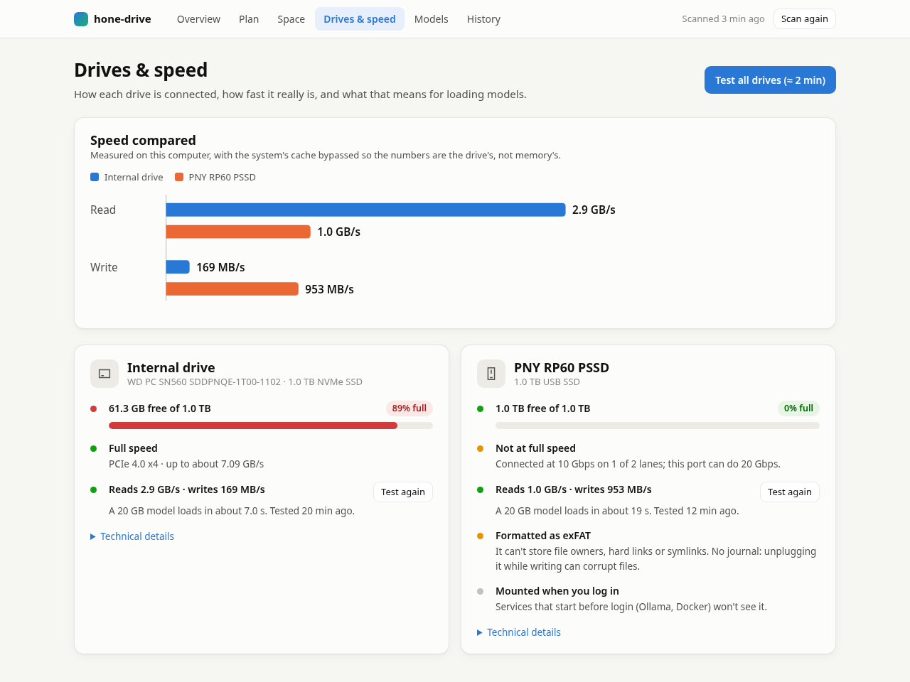
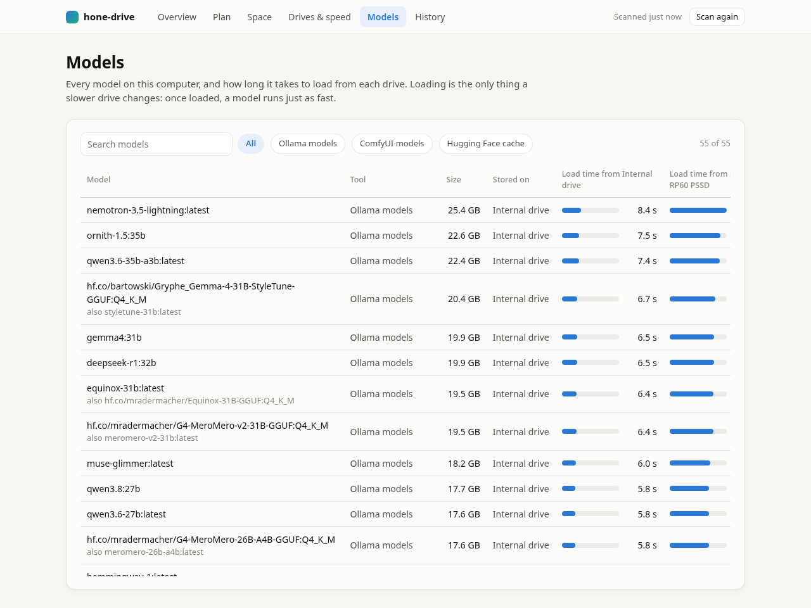
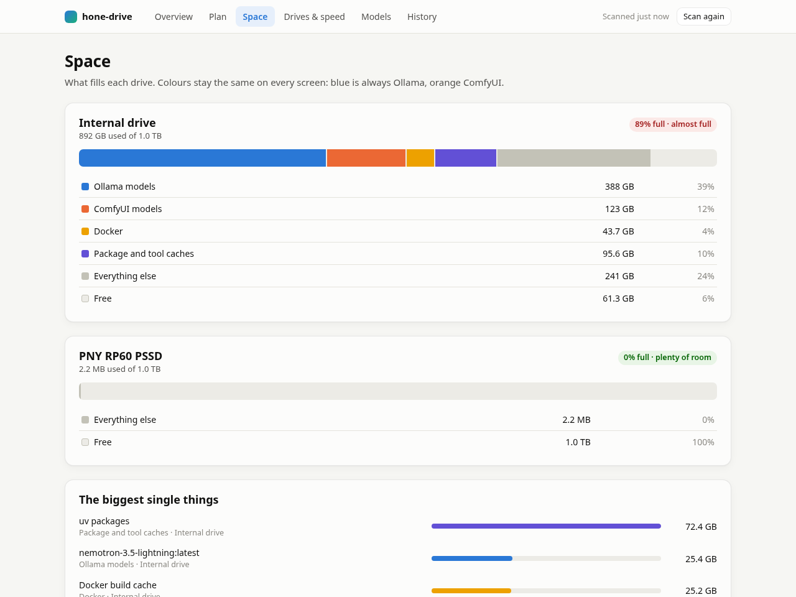

# hone-drive

[](https://github.com/honeworks/hone-drive/actions/workflows/ci.yml)

**A storage dashboard for AI developers.** Find out what is filling your disks (Ollama, ComfyUI, Hugging
Face, Docker, package caches), how fast each drive really is, how long your own models take to load from
each one, and get a step-by-step plan, with the exact commands for your system, to free space and move
models to an external SSD. Linux, macOS and Windows. Runs locally, works offline, needs no administrator
rights, and never changes anything itself.

Part of **[honeworks](https://github.com/honeworks)**: small, standalone tools for reliable generative-AI
workflows.



## Why this exists

If you run models locally, your disk fills up fast. A few dozen Ollama models, a ComfyUI install with
video models, a Hugging Face cache, Docker images and a uv cache add up to hundreds of gigabytes. The day
the disk is full, you buy an external SSD, and the questions start:

- **Where did the space go?** The usual tools miss the biggest folders. Model servers run as their own
  user (Ollama on Linux keeps its models in `/usr/share/ollama`, which your user can't read), Docker hides
  its images behind root, and `du` quietly skips what it can't open. On the machine this tool started
  from, a normal scan found 424 GB of an 830 GB disk. The missing 362 GB were Ollama models.
- **Is the new drive fast enough for models?** The box says 2,000 MB/s. On that machine the drive
  connected at 10 Gbps instead of 20, on both ports tried, and read at 1 GB/s. Nothing on screen said so,
  or that a cable might be the cause.
- **How much slower will my models load?** You want the answer in seconds for *your* models, not in MB/s
  at queue depth 32. Many quick benchmarks also measure RAM instead of the drive, because they don't
  bypass the operating system's cache.
- **Is my internal drive OK?** A nearly full SSD writes slowly. The internal drive in that session read at
  3 GB/s but wrote at 0.17 GB/s at 89% full, five times slower than the external drive.
- **What should I move, and how?** Every tool has its own setting for where models live (`OLLAMA_MODELS`,
  `HF_HOME`, ComfyUI's `extra_model_paths.yaml`, LM Studio's folder). Some caches must stay on the same
  drive as your projects. An exFAT drive can't hold files owned by the Ollama service user. Most people
  learn this by breaking something.

Answering those questions took an afternoon of shell commands, `sudo` round trips and two wrong guesses.
hone-drive answers them in a minute. The full story, with every measurement, is in
[design/history/0000-research.md](design/history/0000-research.md).

## What it does

- **Finds every drive and how it's connected.** Internal and external, NVMe, SATA, USB and Thunderbolt,
  with the speed the connection actually negotiated against what the port can do: "connected at 10 Gbps
  on 1 of 2 lanes; this port can do 20 Gbps".
- **Shows what fills each drive.** Ollama (through its local server when its folder belongs to another
  user), Hugging Face, ComfyUI (including `extra_model_paths.yaml`), LM Studio, llama.cpp, Docker
  (including the containerd image store), and about a dozen package caches (uv, pip, npm, pnpm, conda,
  PyTorch hub, Whisper, Playwright, pacman, apt, dnf, Homebrew). Files shared between two model names
  are counted once.
- **Finds the space nobody can see.** An optional walk compares what your user can read with what the
  drive reports as used, and says where the rest is probably hiding and which command would measure it.
- **Measures real speed.** Sequential write and read, a long write that shows when a drive's fast cache
  runs out, random reads, and reads of your own model files, always with the operating system's cache
  bypassed, so the numbers are the drive's and not your RAM's.
- **Speaks in seconds.** "gemma4:31b loads in about 6.5 s from the internal drive and 19 s from the PNY."
  Only loading gets slower on a slower drive: once loaded, a model runs just as fast.
- **Gives you a plan.** Ordered steps (clean caches, prepare the external drive, move model folders, get
  full speed), each with what it frees and the commands for your system to copy. hone-drive never runs
  them.
- **Keeps history and makes reports.** Compare two scans after changing a cable or freeing space. Share a
  report with serial numbers, user and computer names removed.

| | |
|---|---|
|  |  |
|  |  |

## Install and run

hone-drive is not on PyPI yet. With [uv](https://docs.astral.sh/uv/), run it straight from GitHub:

```bash
uvx --from git+https://github.com/honeworks/hone-drive hone-drive
```

That opens the dashboard in your browser. Click **Scan this computer**, then **Test all drives**. To
install it instead:

```bash
uv tool install git+https://github.com/honeworks/hone-drive
# or: pipx install git+https://github.com/honeworks/hone-drive
hone-drive
```

Python 3.11 or newer. It depends only on `psutil` and `pydantic`, and uses nothing but the tools your
operating system already has (`nvidia-smi` and Docker are used when present).

## The command line

Everything in the dashboard is also a command; add `--json` for machine-readable output.

```bash
hone-drive                                # the dashboard (127.0.0.1, a free port)
hone-drive scan                           # drives, connections, volumes and what fills them
hone-drive scan --account --duplicates    # also find hidden space and duplicate files (slower)
hone-drive bench --tests seq,model        # measure your home drive and every external drive
hone-drive bench /mnt/models --size 8G    # measure one drive with a bigger test file
hone-drive advise                         # the plan, with commands for your system
hone-drive compare 20261018T193558Z-b61168   # what changed since an earlier scan
hone-drive report > report.md             # a report to share, private details removed
hone-drive runs                           # stored scans, newest first
```

Example output of `hone-drive scan` on the machine it was built on:

```text
nvme0n1: WD PC SN560 SDDPNQE-1T00-1102 · 1.0 TB · nvme, internal · PCIe 4.0 x4
sda: PNY RP60 PSSD · 1.0 TB · usb-ssd, external · 10 of 20 Gbps, 1 of 2 lanes  ← LIMITED

/: ext4 · 892 GB used of 1.0 TB (89%) · 61.7 GB free
/run/media/user/PNYRP60PSSD: exfat · 2.2 MB used of 1.0 TB (0%) · 1.0 TB free

   388 GB  Ollama models  /usr/share/ollama/.ollama/models (via the Ollama server: its folder is not readable)
   123 GB  ComfyUI models  ~/ComfyUI/models
  95.6 GB  Package and tool caches  several folders
  43.7 GB  Docker  /var/lib/containerd
```

## Use it from Python

```python
from pathlib import Path
from hone_drive import BenchOptions, advise, bench, load_time, scan

run = scan()  # drives, volumes and stores, in seconds
run = bench(run, [str(Path.home()), "/mnt/models"], ["seq", "model"], BenchOptions(size=4 * 1024**3))
for item in advise(run, str(Path.home())):
    print(item.severity, item.title, item.gain.bytes_freed)

model = next(i for s in run.stores if s.id == "ollama" for i in s.items)
print(load_time(model, "/mnt/models", run))  # seconds, a range, and what it is based on
```

`hone_drive.testing` has `FakeProbe`, recorded machines and a contract checker for tests of your own.

## What it will never do

- **Change anything.** It never moves, deletes, formats or mounts. Every command in the plan is for you
  to read and run. The only file it writes outside its own data folder is the benchmark's temporary
  file, which is removed afterwards; if the process is killed, the next run cleans it up.
- **Need administrator rights.** When a folder can't be read, it says so and shows the command that would
  measure it. It never counts an unreadable folder as empty.
- **Guess.** A fact the operating system can't provide is shown as unknown, with the reason. Every speed
  is measured and labelled with how the cache was bypassed, or marked as an estimate with what it's
  based on.
- **Send anything anywhere.** No telemetry and no network access: the dashboard is served on 127.0.0.1
  only, refuses other host names, and accepts changes only from its own page.
- **Fill your drive.** A write test checks for room first and stops if free space falls under 2 GB.

## Platform support

| | Linux | macOS | Windows |
|---|---|---|---|
| Drives, volumes, usage | yes (sysfs) | yes (`diskutil`) | yes (storage cmdlets) |
| Connection speed and lanes | USB, Thunderbolt, PCIe, SATA | USB, NVMe | not reported by Windows |
| Benchmarks with the cache bypassed | `O_DIRECT` | `F_NOCACHE` | `FILE_FLAG_NO_BUFFERING` |
| Tested on a real machine | yes | not yet | not yet |

The macOS and Windows code is tested against hand-written fixtures and in CI. If you run hone-drive on a
Mac or a PC, a recording of your machine helps a lot: `python -m hone_drive.testing my-machine.json`
records what the probe sees with serial numbers, UUIDs and names replaced. Please open an issue with it.

## Questions

**Why is my USB SSD stuck at about 1 GB/s?** A 10 Gbps USB connection carries about 1.05 GB/s. If the
Drives screen says the port can do 20 Gbps, try the cable that came with the drive (20 Gbps needs a
full-featured USB-C cable), plug it in without a hub or adapter, then scan again.

**Will my models run slower from an external drive?** Only loading is slower. Generation runs from GPU
memory and RAM. A model you loaded recently may even load from the operating system's cache.

**Should I keep the drive as exFAT?** Only if you move it between Windows, macOS and Linux. For a drive
that stays with one machine, use its native filesystem (ext4, APFS, NTFS): exFAT can't store file
owners, links or a journal, and a service such as Ollama on Linux can't own its files there.

**Where are scans stored?** In `~/.local/share/hone-drive` on Linux, `~/Library/Application
Support/hone-drive` on macOS and `%LOCALAPPDATA%\hone-drive` on Windows (or `HONE_DRIVE_HOME`). They
never leave your computer unless you share a report.

## Development

```bash
uv sync --all-extras
scripts/check.sh            # lint, format, types, tests with coverage, build, wheel smoke test
uv run hone-drive           # the dashboard from your checkout
```

Read [CONTRIBUTING.md](CONTRIBUTING.md) first; contributors using AI coding tools will find a brief in
[AGENTS.md](AGENTS.md). The design is in [design/current.md](design/current.md), and every design
change has a record in [design/changes/](design/changes/).

## How this was built

Specified by a human; designed and built by AI against a written design and tests; every decision
reviewed by a human. The design history is in [design/changes/](design/changes/) and
[design/decisions.md](design/decisions.md); the session that started it is in
[design/history/0000-research.md](design/history/0000-research.md).

## License

Apache-2.0.
